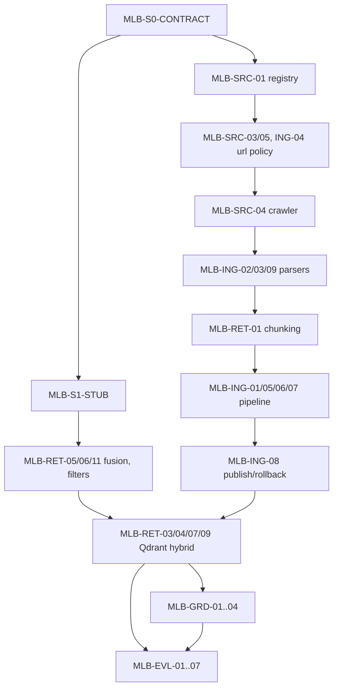

# Старт ML + Backend: анализ и первая группа задач

## 1. Спецификации

- Спецификация №1 (SSOT): [docs/SPEC_MTS_VOICE_AGENT_TRACK1.md](docs/SPEC_MTS_VOICE_AGENT_TRACK1.md), версия 1.1 от 13.10.2026, трек 1. Это единственная актуальная копия.
- Спецификация №2 (декомпозиция): [docs/MTS_VOICE_AGENT_4_DEVELOPERS.md](docs/MTS_VOICE_AGENT_4_DEVELOPERS.md), версия 1.0 от 11.10.2026.
- Неоднозначность: спецификация №2 ссылается на `SPEC_MTS_VOICE_AGENT.md`. В коммите `60546a6` этот файл переименован и переписан: v1.0 описывал публичную базу знаний МТС, v1.1 — мультитенантный агент входящих звонков. Номера разделов §1–§18 совпадают, поэтому ссылки остаются валидными, но содержание §6 изменилось.

## 2. Задачи ML + Backend

В спецификации №2 у задач нет ID. Ниже ID присвоены мной, в скобках указаны строки §4 спецификации №2.

- `MLB-S0-CONTRACT` — контракты ingestion и `retrieve`, формат source metadata (Этап 0, L66–67). Покрывает SSOT §6.5, §14.2, §9.
- `MLB-S1-STUB` — подключаемый retrieval stub или минимальный индекс (Этап 1, L84–85). SSOT §15, Этап 1.
- Источники и crawling (SSOT §6.1–6.2, §4.3 зона D, §17):
  - `MLB-SRC-01` — версионируемый реестр (L208–210);
  - `MLB-SRC-02` — покрытие тем (L211–213);
  - `MLB-SRC-03` — исключение авторизованных зон (L214–215);
  - `MLB-SRC-04` — allowlist, rate limit, timeout, retry и защита от crawler traps (L216–217);
  - `MLB-SRC-05` — robots.txt и ручное исключение (L218–219);
  - `MLB-SRC-06` — отчёт покрытия (L220–221).
- Ingestion (SSOT §6.2–6.6, §6.9, NFR-07):
  - `MLB-ING-01` — конвейер fetch…publish (L225–226);
  - `MLB-ING-02` — HTML и документы с метаданными (L227–228);
  - `MLB-ING-03` — удаление boilerplate (L229–230);
  - `MLB-ING-04` — дедупликация по canonical URL и hash (L231–232);
  - `MLB-ING-05` — provenance на уровне chunk (L233–234);
  - `MLB-ING-06` — изоляция ошибок и идемпотентность (L235–236);
  - `MLB-ING-07` — dry-run и отчёт (L237);
  - `MLB-ING-08` — атомарная публикация и rollback (L238–239);
  - `MLB-ING-09` — таблицы и цены (L240–241).
- Chunking и retrieval (SSOT §6.6–6.7, §6.9, §4.2):
  - `MLB-RET-01` — структурный chunking (L245–246);
  - `MLB-RET-02` — подбор размера и overlap (L247–248);
  - `MLB-RET-03` — выбор embeddings (L249–250);
  - `MLB-RET-04` — dense в Qdrant и sparse (L251–252);
  - `MLB-RET-05` — RRF (L253–254);
  - `MLB-RET-06` — фильтры (L255–256);
  - `MLB-RET-07` — retrieval API по SSOT (L257–258);
  - `MLB-RET-08` — нормализация запроса (L259–260);
  - `MLB-RET-09` — дедупликация и reranker (L261–262);
  - `MLB-RET-10` — стабильные ссылки и фрагменты (L263);
  - `MLB-RET-11` — пустой результат как штатный исход (L264–265);
  - `MLB-RET-12` — кэш (L266–267);
  - `MLB-RET-13` — health Qdrant (L268–269).
- Grounding (SSOT §6.3, §6.8, §7.2, §11.4):
  - `MLB-GRD-01` — пороги abstention (L273–274);
  - `MLB-GRD-02` — приоритет актуального источника (L275–276);
  - `MLB-GRD-03` — минимальный и недоверенный evidence (L277–278);
  - `MLB-GRD-04` — «недостаточно подтверждений» (L279–280).
- Evaluation (SSOT §11.3–11.5, §11.8):
  - `MLB-EVL-01` — набор вопросов (L281–282);
  - `MLB-EVL-02` — разметка (L283–284);
  - `MLB-EVL-03` — метрики (L285–286);
  - `MLB-EVL-04` — сравнение конфигураций (L287–288);
  - `MLB-EVL-05` — regression gate (L289–290);
  - `MLB-EVL-06` — prompt injection в источниках (L291);
  - `MLB-EVL-07` — перечень неразобранных документов (L292–293).
- `MLB-DOC` — артефакты и DoD: `rag/README.md` и прочее (L295–303), SSOT §16.

Требования SSOT в моей зоне, которых нет в спецификации №2. Добавляю их в соответствующие задачи:
- изоляция tenant в KB: FR-09, NFR-11, §11.1;
- одобрение источника владельцем до попадания в active index: §6.1;
- `removed_at_source`: §6.4;
- `valid_from`/`valid_to`: §6.3;
- conditional GET: §6.2.5;
- fallback на sparse при отказе embedder или reranker: §6.9;
- ежедневные проверки индекса: §6.9;
- каскадное удаление из индексов и кэшей: §7.4;
- `models.lock.yaml` и лицензии: §4.2, §16.6;
- время в UTC с отображением в Europe/Minsk: §6.2.7.

## 3. Текущее состояние репозитория

Кода нет. В репозитории только 2 спецификации, [AGENTS.md](AGENTS.md), правила и агенты в `.cursor/`. Нет pyproject, CI, тестов и Docker Compose. Статус всех задач: `PENDING`.

## 4. Зависимости от других ролей

- Backend + ML-Flow:
  - общий workspace, CI и Docker Compose с Qdrant, Redis и PostgreSQL;
  - миграции;
  - admin API `/admin/knowledge/*` с RBAC `knowledge_editor` и аудитом;
  - сохранение `retrieval_events`;
  - валидация вывода (проверка `citation_ids`);
  - вызов `retrieve` из оркестратора с deadline и cancellation;
  - Redis для кэша.
- ML: ASR-зашумлённые варианты запросов для eval (Этап 2, «измерить влияние ASR-ошибок на retrieval»).
- Frontend: прямой зависимости нет, всё идёт через API Backend + ML-Flow.

## 5. Противоречия, пробелы и блокеры

- C1. Устаревшее имя SSOT в спецификации №2. Следую v1.1.
- C2. Миссия «база публичной информации МТС» (спецификация №2 L195–213) противоречит tenant-scoped подходу SSOT (§1, §2.4, §6.1, §18.4). Решение по SSOT: корпус `mts.by` существует только как tenant `mts-public-demo`, `MLB-SRC-02` относится только к нему.
- C3. `retrieve(query, filters, top_k)` (спецификация №2 L66–67) отличается от SSOT §14.2. Решение по SSOT: в сигнатуре обязателен `tenant_id`, `top_k` не входит в сигнатуру и задаётся в конфиге retrieval (§6.7: `context_top_k=6` и т. д.).
- C4. Каталоги `rag/` и `knowledge/` противоречат SSOT §13. Решение по SSOT: `packages/rag` и `apps/ingestion`.
- C5. Не определено, кто владеет миграциями таблиц `knowledge_documents/revisions/chunks/ingestion_runs` (SSOT §8.3, спецификация №2 L395). Это **BLOCKED** для слоя PostgreSQL. Пока работаем через интерфейс репозитория (store) с in-memory и файловой реализацией, вопрос задам позже.
- C6. Внутреннее противоречие SSOT: в §17 есть `ihelper.mts.by/selfcare/`, а §6.2.3 запрещает `/selfcare`. Решение: URL попадает в реестр со статусом `excluded` и указанием причины. `lk.landing.mts.by` получает статус `review_required`.
- C7. Конфигурация агентов: Skill ссылается на `deep-reviewer`, которого нет. В `deep-architect.md` указано `model: claude-opus-5-5[]`, возможно, некорректно. Для HIGH-задач использую сабагент `deep-architect`, а `reviewer` запускаю с явно выбранной более сильной моделью. Фактически использованные модели укажу в отчёте.
- Live-crawling `mts.by` и загрузка моделей и образов Docker (BGE-M3, reranker, Qdrant) требуют сети и вашего разрешения. В первой группе их нет.

## 6. План выполнения

Группа 1, выполняется сейчас:
- `MLB-S0-CONTRACT`, **HIGH**: межмодульный контракт, изоляция tenant, противоречия C2 и C3.
- `MLB-SRC-01`, **MEDIUM**: версионирование и валидация реестра.
- `MLB-SRC-03`, **MEDIUM**: граница безопасности по URL.
- `MLB-SRC-05`, **LOW**: локальная логика robots.txt и ручных исключений.
- `MLB-ING-04`, **MEDIUM**: canonicalization влияет на идентичность документа.
- `MLB-S1-STUB`, **LOW**: in-memory реализация протокола.
- `MLB-RET-05`, **LOW**: детерминированная функция RRF.
- `MLB-RET-06`, **MEDIUM**: фильтр tenant обязателен.
- `MLB-RET-11`, **LOW**.

Группа 2:
- `MLB-SRC-04`, **MEDIUM**: работа с сетью и отказами.
- `MLB-ING-02/03/09`, **MEDIUM**.
- `MLB-RET-01`, **HIGH**: если отделить цену от параметра, бот ответит ложно.
- `MLB-ING-01/05/06/07`, **MEDIUM**.
- `MLB-ING-08`, **HIGH**: атомарность, конкурентные запуски, целостность данных.

Группа 3, нужны сеть и модели:
- `MLB-RET-03`, **MEDIUM**: лицензии и lock.
- `MLB-RET-04/07`, **HIGH**: изоляция tenant в Qdrant, контракт.
- `MLB-RET-08/09/12`, **MEDIUM**.
- `MLB-RET-10/13`, **LOW**.

Группа 4:
- `MLB-GRD-02/04`, **HIGH**: fail-closed по ценам и конфликтам.
- `MLB-GRD-01/03`, **MEDIUM**.
- `MLB-EVL-01..07`, **MEDIUM**: не менее 150 синтетических запросов, Recall@10 ≥ 0.90, nDCG@10 ≥ 0.80, abstention ≥ 0.98.
- `MLB-RET-02`, **MEDIUM**.

Группа 5, после вашего разрешения: live dry-run по `mts-public-demo`, `MLB-SRC-02/06`, `MLB-DOC`.

Маршрутизация агентов:
- LOW — `implementer` с экономичной моделью Composer 2.5 fast.
- MEDIUM — `implementer` с моделью по умолчанию и точечным анализом сложных участков.
- HIGH — `deep-architect` до реализации и `reviewer` с более сильной моделью после.
- Группа 1 содержит HIGH-задачу, поэтому выполняется полный цикл: `deep-architect` (план контрактов), затем один `implementer` (без параллельных писателей), затем `reviewer`, затем не более двух циклов исправлений.

## 7. Первая группа: файлы (изолированные пакеты)

- `packages/contracts/knowledge/pyproject.toml` и `src/mts_contracts/knowledge/`: Pydantic-модели и протокол. Используется namespace package `mts_contracts`, чтобы Backend + ML-Flow мог добавить свои модули в тот же пакет.
  - `SourceRecord`: tenant_id, url, type, priority, allow/deny paths, refresh interval, status (`active|excluded|review_required`), owner, approval, exclusion reason.
  - `ChunkMetadata`: все поля SSOT §6.5.
  - `IngestionRunReport`: added/changed/unchanged/deleted/failed/skipped.
  - `RetrievalFilters`, `RetrievalResult` с candidate diagnostics, `index_revision`, `evidence_status`.
  - `KnowledgeRetriever` строго по SSOT §14.2.
  - Типизированные ошибки.
- `apps/ingestion/` (`mts_ingestion`): `registry.py` (загрузка и валидация YAML, проверка изоляции tenant), `url_policy.py` (allowlist, запрещённые шаблоны вроде `/login`, `/selfcare`, `/account` и путей с токенами, canonicalization с удалением tracking-параметров, content hash), `robots.py`.
- `packages/rag/` (`mts_rag`): `fusion.py` (RRF), `filters.py`, `stub.py` (in-memory `KnowledgeRetriever` с обязательным фильтром tenant, пустой результат как штатный исход), `README.md`.
- `config/sources.by_tenant.yaml` — синтетический бизнес-tenant; `config/legacy_demo_sources.mts.by.yaml` — URL из SSOT §17 для `mts-public-demo` с учётом C6.
- `docs/adr/ADR-0001-knowledge-contracts-track1.md` — фиксирует C1–C6 по требованию спецификации №2 §9.4.
- Зависимости: `pydantic`, `PyYAML` (runtime); `pytest`, `pytest-asyncio`, `ruff`, `mypy` (dev). Ставятся в conda-окружение `mach` через `pip install -e`. Окружение лежит вне workspace, на это понадобится разрешение.

## 8. Тестирование и приёмка группы 1

Команды выполняются в `conda run -n mach` для каждого пакета: `pytest`, `ruff check`, `mypy --strict`.

Обязательные тест-кейсы:
- изоляция tenant: stub не возвращает chunk чужого tenant даже при совпадении текста или подставленном ID; пустой `tenant_id` отклоняется;
- метаданные chunk: отсутствие обязательных полей §6.5 считается ошибкой валидации;
- реестр: дубли и URL вне allowlist отклоняются, `selfcare`, `login` и URL с токенами получают статус `excluded` с причиной, источник без одобрения не считается indexable;
- canonicalization: удаляются `utm_*`, fragment, сохраняются значимые query-параметры, результат идемпотентен; hash не зависит от пробельного шума;
- RRF: детерминированный порядок, разрешение равенства, поведение на пустых списках;
- фильтры: language, audience, service, `effective_status`, `valid_to` в прошлом исключает chunk;
- пустой результат даёт `evidence_status=no_evidence` без исключения;
- robots.txt: disallow соблюдается, ручное исключение записывается с причиной.

Статус `VERIFIED` задача получает только после реально выполненных тестов и вердикта Reviewer без CRITICAL и HIGH замечаний. В итоговом отчёте будут ID задач, ссылки на SSOT, изменённые файлы, фактический вывод команд, вердикт, блокеры (C5, сеть и модели) и следующий шаг (группа 2).

Commit, push, live-crawling и загрузка моделей выполняются только с вашего явного разрешения.
